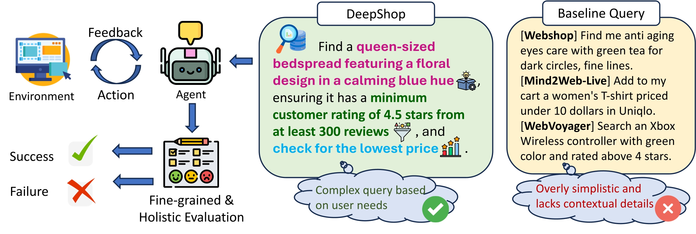
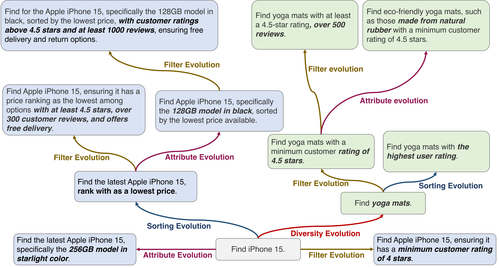

# DeepShop: A Benchmark for Deep Research Shopping Agents

> This branch contains the ECIR 2027 resource revision for review. The `main` branch is unchanged.

DeepShop evaluates web shopping agents on controlled multi-constraint tasks in a live online shopping environment. Tasks combine product attributes, search filters, and sorting preferences. The released benchmark contains 150 tasks across five product categories and three difficulty levels.

[Paper](https://arxiv.org/abs/2506.02839) · [ECIR supplementary material](./ECIR2027_DeepShop_Supplementary.pdf) · [Saved-result analysis](./analysis/ecir2027/README.md) · [Code license](./LICENSE.txt)



## Released resources

| Resource | Contents |
| --- | --- |
| `data/shopping_seed.jsonl` | 50 seed queries |
| `data/deepshop_evol_600.jsonl` | 600 evolved candidates |
| `data/deepshop_evol_600_subquery.jsonl` | Candidate subqueries and difficulty labels |
| `data/deepshop_filter_150.jsonl` | Final benchmark: 150 tasks; 30 per category and 50 per difficulty level |
| `data/deepshop_example.jsonl`, `results/example/` | 10 tasks with saved example trajectories and screenshots |
| `src/evaluation/`, `scripts/run_evaluation.sh` | Evaluation of saved agent trajectories |
| `analysis/ecir2027/` | Saved task outcomes for four original baselines and offline statistical recomputation |
| `src/data_process/`, `scripts/run_data_evolution.sh` | Query-construction scripts |

Categories are Books, Electronics, Home, Fashion, and Sports. Difficulty labels are easy, medium, and hard. The example trajectories demonstrate the evaluation input format; they are not a complete set of trajectories for all reported systems. The evaluation scripts score trajectories supplied by an agent implementation; they do not launch a browser agent.

## Installation

Tested with Python 3.11.1. Direct dependencies are pinned in `requirements.txt`.

```sh
git clone --branch ecir2027-results-review-v11 https://github.com/youganglyu/DeepShop.git
cd DeepShop
python3 -m venv .venv
. .venv/bin/activate
python -m pip install -r requirements.txt
```

## Quick start without API calls

Recompute overall scores, category and difficulty breakdowns, paired tests, and confidence intervals from the released outcomes of Simple RAG, Agent-E, SeeAct, and Browser Use:

```sh
python analysis/ecir2027/recompute_result_statistics.py
```

This reads saved binary outcomes and prints JSON. It does not rerun agents or judges. See the [analysis documentation](./analysis/ecir2027/README.md) for the scope and statistical definitions.

Validate the 10 supplied example trajectories:

```sh
sh scripts/run_evaluation.sh \
  --dataset data/deepshop_example.jsonl \
  --run-name example \
  --results-dir results \
  --dry-run
```

A successful dry run reports 10 tasks and 10 trajectories, checks required inputs and PNG headers, and exits without API calls or result files. Missing trajectories, duplicate task IDs, or malformed inputs cause a nonzero exit. Dry-run validation does not establish whether a task was successfully solved.

## Evaluate trajectories from your agent

Run your agent separately on the released tasks. Store each trajectory under its task ID:

```text
results/my-agent/
└── taskAmazon--14/
    ├── interact_messages.json
    ├── screenshot1.png
    └── screenshot2.png
```

`interact_messages.json` is a JSON array of message objects with a `content` field. Following the supplied examples, a completed trajectory ends with `Action: ANSWER; <final answer>` in its last message. Content can be a string or a list of text blocks. Screenshots use sequential names `screenshot1.png`, `screenshot2.png`, etc.; the evaluator attaches the last 15 by default. A supplied trajectory without a final answer receives failure on its applicable dimensions. A missing trajectory is an input error, not an automatically assigned failure.

First validate your full 150-task run:

```sh
sh scripts/run_evaluation.sh \
  --dataset data/deepshop_filter_150.jsonl \
  --run-name my-agent \
  --results-dir results \
  --dry-run
```

For new judge calls, copy `.env.example` to `.env` and set `OPENAI_API_KEY`. Set `OPENAI_BASE_URL` only when using an OpenAI-compatible endpoint. Environment variables take precedence over `.env`.

```sh
cp .env.example .env
# Edit .env to supply your API key before running the next command.
sh scripts/run_evaluation.sh \
  --dataset data/deepshop_filter_150.jsonl \
  --run-name my-agent \
  --results-dir results \
  --api-model gpt-4o \
  --output-dir results/evaluations/my-agent
```

This command makes paid judge API calls. Select an available vision-capable model for `--api-model`; `gpt-4o` is the default alias. Output records the requested model and, where returned by the API, the resolved response model. New calls do not reproduce a historical model snapshot or shopping environment. Use the offline analysis command to recompute the released historical results.

New outputs are `attribute.json`, `filter.json`, `sort.json`, and `overall.json`. Each contains task IDs, run metadata, and a dataset SHA-256 hash. Dimension scores use only applicable tasks as their denominators. Overall success requires every applicable dimension to succeed; absent dimensions are satisfied by convention. Aggregation joins by task ID and rejects missing, duplicate, or mismatched records. Historical `.npy` result arrays are not read or overwritten. Existing output files are never replaced; choose a fresh output directory for another evaluation.

Paths supplied on the command line are relative to the working directory. Set `PYTHON=/path/to/python` to use a specific interpreter with the shell scripts.

## Task format

```json
{
  "web_name": "Amazon",
  "id": "Amazon--14",
  "ques": "Find the new surge protector on Amazon with 6 to 8 outlets under 25 dollars with customer reviews above 4+ stars.",
  "web": "https://www.amazon.com/?language=en_US&currency=USD",
  "attribute": "New surge protector with 6 to 8 outlets under 25 dollars",
  "filter": "Surge protector with customer reviews above 4+ stars",
  "sort": "None",
  "category": "Electronics",
  "difficulty": "easy"
}
```

`id` is the join key for tasks and evaluation records. `ques` is the complete task; `attribute`, `filter`, and `sort` contain dimension-specific requirements. `"None"` marks an absent requirement. `web` identifies the target website. Category and difficulty labels support grouped analysis.

## Query construction



The construction pipeline expands seed queries across categories and applies five rounds of complexity evolution to build a controlled pool of shopping constraints. The released JSONL files are the fixed benchmark artifacts; running construction again generates new candidates and can change the dataset.

For construction experiments, use a separate checkout, configure API access, and run:

```sh
sh scripts/run_data_evolution.sh
```

This invokes API-dependent query evolution and decomposition, then filtering, and writes files under `data/`. It is not needed to use the released benchmark or recompute its saved results.

## Tests and license

Offline evaluator checks can be run with:

```sh
python -m unittest discover -s tests -v
```

Code is provided under the [MIT license](./LICENSE.txt). Third-party website content remains subject to its respective rights and terms.
